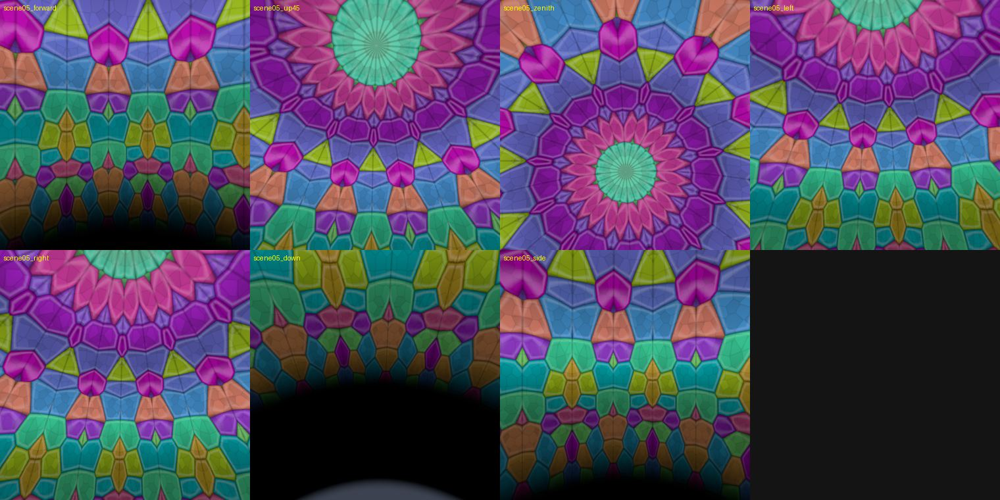
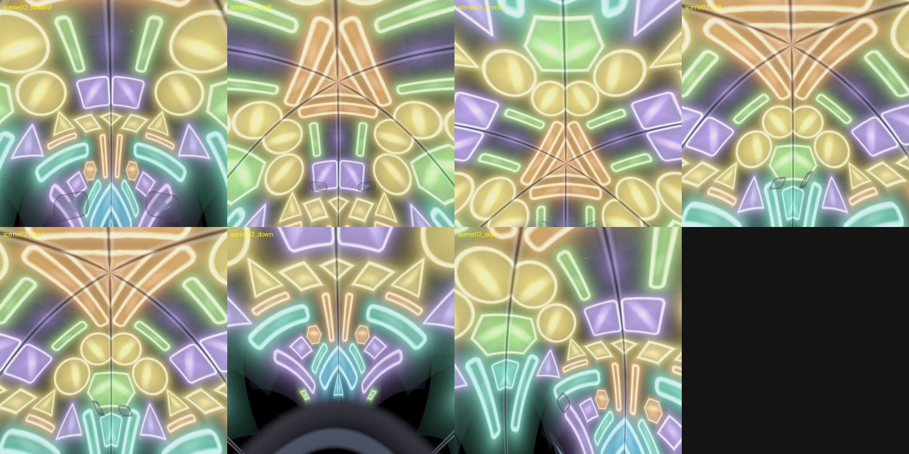
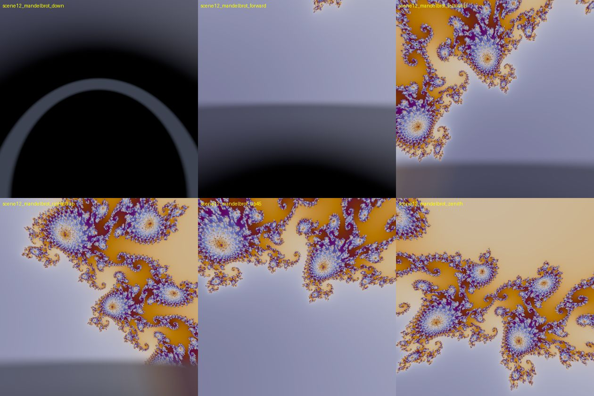

# 空间万花筒 · Spatial Kaleidoscope (PICO Space Pro / PICO OS 6)

PICO Space Pro（Swan）上的沉浸式 Full Space 程序化万花筒。打开即沉浸，没有菜单和指针：
10 个场景固定循环，只有 **下一个 / 上一个 / 暂停** 三条操作（眼手捏合或 VR 手柄）。
实现依据 `docs/空间万花筒_PRD_v0.6_Swan_眼手与VR手柄_含原图.docx`。

| 场景 | 内容 | 实现 |
| --- | --- | --- |
| 1 | 两镜·暗场发光珠 | 2D 物理碎片腔（Box2D，SDF 抗锯齿碎片）→ 45° 镜室 8 分区镜像；cell 相机只取景可见楔形（2048 texel/半径），光晕由 SDF 解析计算 |
| 2 | 两镜·六重玻璃 | 60° 镜室 6 分区镜像，水晶质感（切边、斜面、面光） |
| 3 | 程序万花筒 | 12 折镜像 + 双层 cellular 彩色玻璃格，相位 60 s 一圈（6°/s） |
| 4 | 曼陀罗 | 16 折蕾丝线族，屏幕空间等宽（fwidth）抗锯齿线条，环向外流动 1× |
| 5 | Julia 集 | c 沿主心形线内侧 90 s 闭合路径；2048² 贴图，双缓冲两帧分带计算（每帧成本约为 1024² 四倍超采样的一半） |
| 6 | Mandelbulb | 每眼 0.6× 分辨率射线步进，footprint 自适应法线/AO，power 6.5–8.5 120 s 往返，6°/s 自转 |
| 7 | 分形树 | L-system 3D 树，30 s 生长 / 10 s 停留 / 淡出重长 |
| 8 | Lorenz | RK4 实时积分，3 s 发光拖尾 + 60 s 幽灵轨迹，6°/s 自转 |
| 9 | 叶序螺旋 | 2200 个点，发散角 137.5°±0.13°（60 s 往返；摆幅按 ≤30°/s 角速度上限推导） |
| 10 | Mandelbrot 深潜 | 60 s 指数缩放到 1e10，扰动理论 + 重基；距离估计着色（无斑点）；896² 双缓冲分带（每帧约 0.4M 像素） |

设备评审后删除了原第 1（三镜彩色玻璃）与第 3（三镜花瓣羽毛）两个三镜场景。

穹顶为半径 5 m 的内向球面，图案中心在天顶、穹顶不自转；3D 物体在启动视线前方 2 m、与眼同高、直径 1.2 m，可 6DoF 绕看。
所有演化由独立的演化时钟驱动，暂停时 `dt = 0`（碎片物理、生长、拖尾、分形重算全部冻结，头部追踪照常）。

## 交互（PRD 第 3 节）

| 动作 | 眼手 | VR 手柄 | 键鼠（仅编辑器） |
| --- | --- | --- | --- |
| 下一个 | 短捏，释放生效（指向按钮则执行按钮） | 任一扳机（射线指向按钮则执行按钮） | → / 左键 |
| 上一个 | 捏合指向左侧"<"按钮 | 任一握把 | ← |
| 暂停/继续 | 任一手捏住 1 s（释放不翻页） | A / B / X / Y 任一 | 空格 |

手柄有可见射线（指向按钮时变亮、末端有光点），低头可见常驻的 < 上一个 / 下一个 > 两个按钮。

同帧暂停优先；左右同时翻页不切换；同侧扳机与 A/X 合并为一次按下；追踪丢失或输入源切换取消未完成捏合；
0.6 s 交叉淡入淡出（出场穹顶保持不透明，入场穹顶 alpha 0→1，永不黑帧）；过渡中只保留最后一次翻页请求；
90 s 无有效输入自动下一个（暂停时停止）；20 min 提醒缓慢调暗到 30%，任一输入恢复且被消费；只持久化上次场景编号。

## 工程结构

```
Assets/Kaleido/
  Scripts/Runtime/        PlaybackController · KaleidoInput · NavButtons · PointerRayVisual · FractalTexturePipeline · KaleidoSceneBase · CellPhysics · BrightnessGovernor · HeadTilt
  Scripts/Runtime/Scenes/ 9 个场景类（10 项内容定义，见 KaleidoPlaylist.cs）
  Scripts/Editor/         KaleidoSceneBuilder（生成 Main.unity）· KaleidoBuild（APK）· KaleidoCapture（多角度截图）
  Resources/Shaders/      URP 单通道多视图安全的 HLSL（折叠、cell 混合、Julia/Mandelbrot 计算、射线步进、发光线）
  Scenes/Main.unity       由 KaleidoSceneBuilder 生成（XR Origin + PXR_Manager + 播放控制器）
tools/                    unity.sh（批处理）· verify_emulator.sh · kcmd.py · stableshot.sh · emu.sh
docs/                     PRD 原文与验证截图
Builds/SpatialKaleidoscope.apk
```

技术基线：Unity 6000.0.59f2、URP 17.0.4、PICO Unity SDK 6.1.1（PICO XR 模式，OpenXR 沉浸路径，多视图立体），
Vulkan / ARM64 / IL2CPP / minSdk 29。手部追踪已启用（眼手 Select 来自系统 aim state 的 IndexPinching），眼动未启用（不采集眼动数据）。

## 下载与安装

- **APK**：[GitHub Releases](https://github.com/kejing-dev/SpatialKaleidoscope/releases)（`SpatialKaleidoscope-v<版本>.apk`）；仓库内的 `Builds/SpatialKaleidoscope.apk` 是同一个发布包。
- 安装到 PICO 模拟器 6.1 或 PICO OS 6 设备：`pico-cli app install SpatialKaleidoscope-v0.3.0.apk`，然后 `pico-cli app launch com.kejing.spatialkaleidoscope`。
- 展示条目（介绍、演示视频、截图）：`SpatialKaleidoscope-showcase/`（按 [ai-context](https://github.com/kejing-dev/ai-context) 的 spatial-app-showcase 格式产出，不在本仓库内）。

## 构建与验证

```bash
# 生成场景 + 编译
tools/unity.sh Kaleido.Editor.KaleidoSceneBuilder.Build build-scene
# 发布 APK（Builds/SpatialKaleidoscope.apk）
tools/unity.sh Kaleido.Editor.KaleidoBuild.BuildAndroid build
# 带 TCP 调试口（仅本机 adb forward，可 goto/next/prev/pause/look/warp）的迭代包
KALEIDO_DEBUG=1 tools/unity.sh Kaleido.Editor.KaleidoBuild.BuildAndroid build-debug
# 编辑器内 12 场景 × 6 视角截图（Captures/），以及 12 个过渡的半程截图
tools/unity.sh Kaleido.Editor.KaleidoCapture.RunAll capture
tools/unity.sh Kaleido.Editor.KaleidoCapture.RunTransitions capture-t
# PICO 模拟器：安装、启动、逐场景 7 个头部姿态截图（Captures/emulator/<run>/sheets）
pico-cli emulator start && tools/verify_emulator.sh run1
```

真机（Swan）安装：`pico-cli app install Builds/SpatialKaleidoscope.apk && pico-cli app launch com.kejing.spatialkaleidoscope`。

## 验证截图

见 [docs/screenshots/README.md](docs/screenshots/README.md)：10 个场景的编辑器多视角渲染与 PICO 模拟器（PICO OS 6，XR 模式）7 个头部姿态的截图（v0.3）。





## 已知限制 / 待真机验证

- 模拟器只能验证逻辑与立体合成（软件 GPU ≈1 fps），90 Hz / ≤8 ms 整帧预算、热稳定性须在 Swan 真机用 XR Profiling Toolkit 实测。
- 眼手捏合识别率（≥95%）、手柄配对与按键延迟须在 Swan 真机验收；模拟器无手/手柄输入，运行时逻辑通过调试口回归。
- 首次启动提示为英文 TextMesh（未打包 CJK 字体），3 s 后隐藏。
- 演化时钟为 double，着色器以 float 接收；连续运行 >4 h 后精度下降（PRD 场景为 20 min）。
